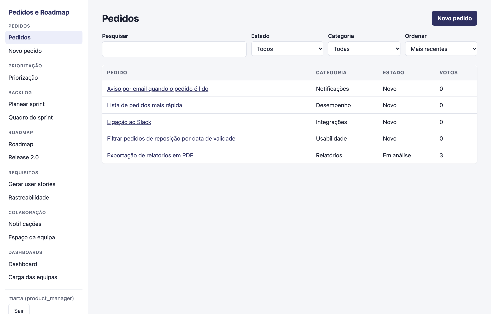
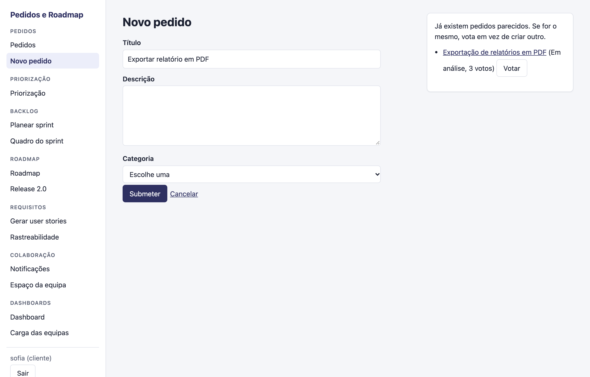
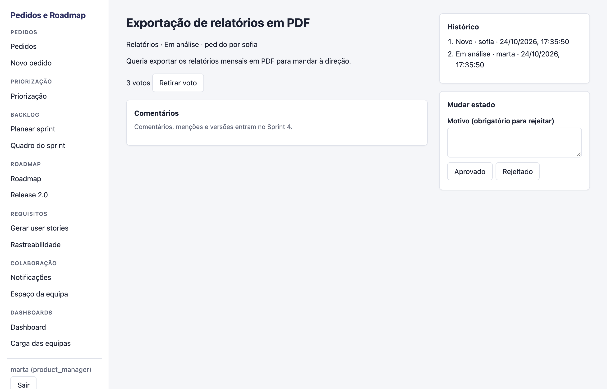
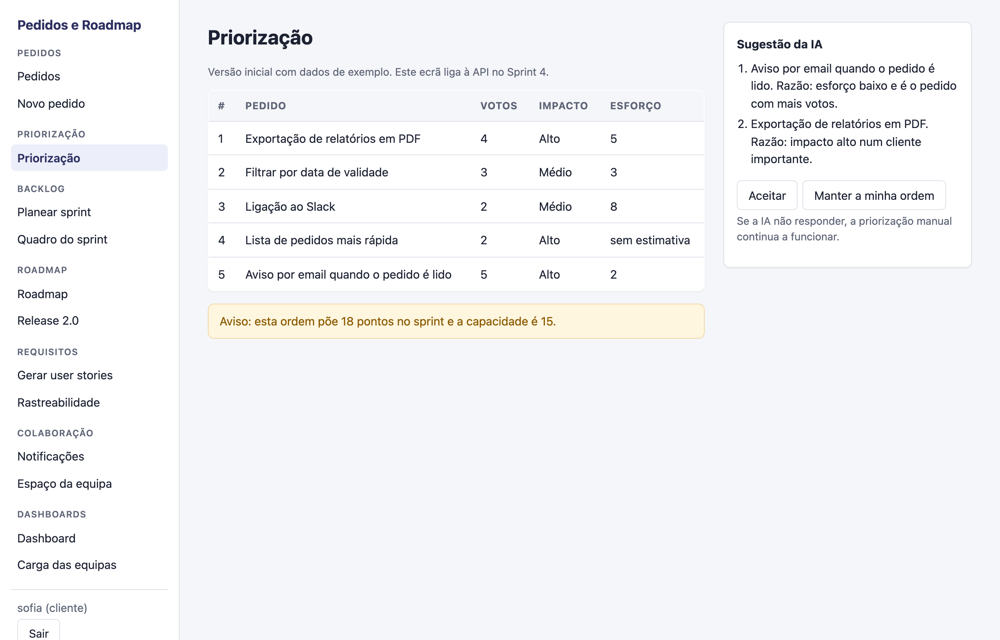
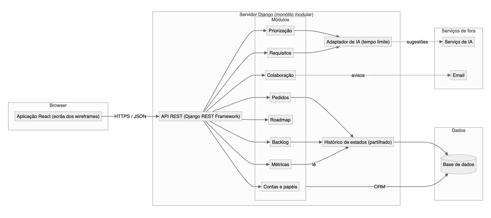
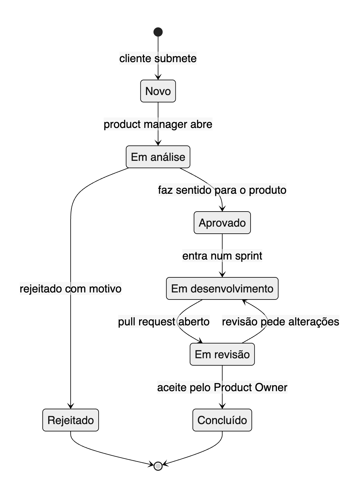
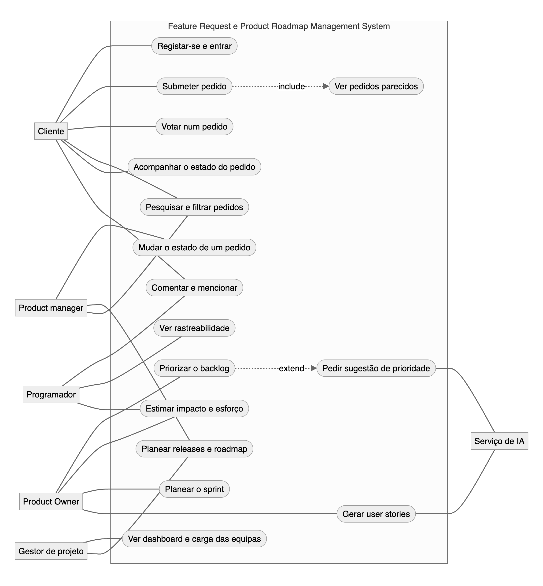
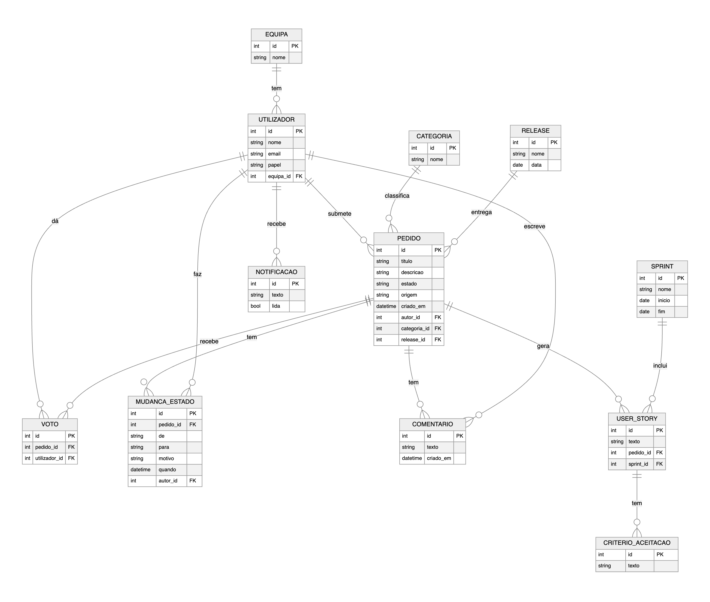

<div align="center">

# Pedidos e Roadmap

**Um sistema para gerir pedidos de funcionalidades e o roadmap de um produto.**

Trabalho de grupo de Engenharia de Software · UBI · 2026/27 · Docentes: Nuno Pombo e Carlos Cunha


[Jira](https://ubi-team-ebw5rr6y.atlassian.net/jira/software/projects/EDS/boards/3) ·
[Confluence](https://ubi-team-ebw5rr6y.atlassian.net/wiki/spaces/EDS/overview) ·
[Wireframes (Figma)](https://www.figma.com/design/VGH6pNIEVkvzY6QtVo8gcr) ·
[Diagramas (FigJam)](https://www.figma.com/board/czxBO7U14mX4uEDGr29P41) ·
[Wiki](wiki/README.md) ·
[Estado atual](wiki/currentstate.md)

<br>



</div>

## O que é

É o *Feature Request & Product Roadmap Management System* que o enunciado propõe. Os clientes submetem pedidos de funcionalidades e votam nos dos outros. A equipa de produto analisa-os, prioriza-os (à mão, por votos ou com uma sugestão de IA), monta o backlog e o sprint e mostra o que vem a seguir no roadmap. Pelo caminho geram-se user stories a partir dos pedidos, comenta-se e acompanha-se tudo em dashboards.

Os requisitos vieram de entrevistas às cinco personas no Character.ai (Sofia, Marta, Ricardo, Diogo e Helena). O dia a dia do trabalho está no Jira, e aqui ficam o código e os documentos.

## A aplicação

Já funcionam os pedidos: criar, procurar, votar, ver o histórico e mudar o estado. Os outros ecrãs dos wireframes existem com dados de exemplo e ligam-se à API nos próximos sprints.

<table>
  <tr>
    <td width="50%"></td>
    <td width="50%"></td>
  </tr>
  <tr>
    <td><b>Novo pedido.</b> Enquanto se escreve o título aparecem os pedidos parecidos, para votar em vez de duplicar.</td>
    <td><b>Detalhe do pedido.</b> Votos, histórico de estados e, para quem gere o produto, a mudança de estado.</td>
  </tr>
  <tr>
    <td></td>
    <td></td>
  </tr>
  <tr>
    <td><b>Priorização.</b> A sugestão da IA aparece ao lado, e a decisão é sempre de quem prioriza.</td>
    <td><b>Pedidos.</b> Pesquisa, filtros por estado e categoria, e ordenação.</td>
  </tr>
</table>

## Como correr

O projeto corre todo em Docker. Só é preciso ter o Docker Desktop aberto e, na pasta do projeto:

```bash
docker compose up --build
```

Sobem três contentores na mesma rede: a base de dados (PostgreSQL), o back-end (Django) e o front-end (React). Depois abre-se **http://localhost:5173**. O código está montado nos contentores, por isso ao guardar um ficheiro a aplicação recarrega sozinha.

Para parar usa-se `Ctrl+C`, e `docker compose down -v` apaga a base de dados para recomeçar do zero. Os testes também correm dentro dos contentores:

```bash
docker compose exec backend python manage.py test
docker compose exec frontend npm test
```

Ao arrancar são criadas contas de teste, uma por papel. A palavra-passe é o nome seguido de `123`:

| Utilizador | Palavra-passe | Papel |
|---|---|---|
| `sofia` | `sofia123` | Cliente |
| `marta` | `marta123` | Product manager |
| `ricardo` | `ricardo123` | Product Owner |
| `diogo` | `diogo123` | Programador |
| `helena` | `helena123` | Gestor de projeto |
| `admin` | `admin123` | Administrador (painel em `/admin/`) |

São contas só para desenvolvimento. Para correr sem Docker (com SQLite) e para mais comandos, ver [como correr](wiki/06-codigo/como-correr.md) e [testes](wiki/06-codigo/testes.md).

## Arquitetura



Escolhemos um monólito modular: uma aplicação React fala por HTTPS/JSON com uma API em Django REST Framework, que guarda os dados em PostgreSQL, dividida em módulos que correspondem às sete áreas do produto (mais contas e papéis). Para uma equipa de cinco pessoas e um semestre, um só servidor é mais simples de montar, testar e pôr a correr do que vários serviços, e os módulos separados deixam dividir o trabalho sem pisar o código uns dos outros. As regras do negócio ficam em `servicos.py` de cada módulo, e a API só trata do HTTP. As razões de cada escolha estão em [decisões](wiki/04-arquitetura/decisoes.md).

## Modelação

<table>
  <tr>
    <td width="38%"></td>
    <td width="62%"></td>
  </tr>
  <tr>
    <td><b>Estados de um pedido</b> (US-12). São os mesmos no código, na API e no Jira.</td>
    <td><b>Casos de uso</b> dos cinco papéis e do serviço de IA.</td>
  </tr>
</table>

<details>
<summary><b>Modelo de dados</b></summary>
<br>

</details>

São oito diagramas: arquitetura, casos de uso, duas sequências, estados, atividades, modelo de dados e classes. Estão todos em Mermaid em [`docs/sprint-3/modelacao/`](docs/sprint-3/modelacao/) e explicados na [wiki](wiki/05-modelacao/casos-de-uso.md). Os sete primeiros também estão no [FigJam](https://www.figma.com/board/czxBO7U14mX4uEDGr29P41).

## Equipa

| Nome | Número |
|---|---|
| Felipe Fogaça | 53394 |
| João Vitor | 53396 |
| Marcus Fernandes | 52822 |
| Rui Machado | 53867 |
| Tiago Pereira | 55019 |

## Sprints

| Sprint | Datas | Product Owner | Scrum Master | O que se fez |
|---|---|---|---|---|
| 1 | 21 set a 14 out | Tiago Pereira | Rui Machado | Equipa, contrato, Jira, produto decidido, primeira proposta de personas, cenários e user stories |
| 2 | 12 a 23 out | Felipe Fogaça | João Vitor | Entrevistas às cinco personas no Character.ai, personas e user stories revistas, wireframes |
| 3 | 23 a 26 out | João Vitor | Marcus Fernandes | Requisitos não funcionais, arquitetura, modelação UML, wireframes corrigidos, base do código, testes, CI e Docker |
| 4 | por confirmar | Marcus Fernandes | Felipe Fogaça | Primeiro incremento completo e ligação dos outros ecrãs à API |
| 5 | por confirmar | Rui Machado | Tiago Pereira | Restantes interfaces, testes, deploy e entrega final |

Cada um é Product Owner uma vez e Scrum Master uma vez, nunca os dois no mesmo sprint. A apresentação oral é no fim de cada sprint. A do Sprint 1 e a do Sprint 2 fizeram-se juntas, porque é o mesmo produto.

## O que está neste repositório

| Pasta | O que é |
|---|---|
| `backend/` | API em Django REST Framework (módulos `contas` e `pedidos`) e os seus testes |
| `frontend/` | Aplicação React com os 15 ecrãs dos wireframes e os seus testes |
| `docker-compose.yml` | Levanta o projeto inteiro: PostgreSQL, back-end e front-end na mesma rede |
| `.github/workflows/` | Integração contínua: corre os testes em cada push e pull request |
| `wiki/` | Documentação em Markdown: produto, requisitos, protótipo, arquitetura, modelação, código e Scrum. Começa no [índice](wiki/README.md) |
| `AGENTS.md` | Regras para quem trabalha no repositório, pessoas ou ferramentas de IA |
| `docs/contrato/` | Contrato de equipa (o `.tex` é a versão de referência) |
| `docs/sprint-1/` | Análise do produto: papéis, sete áreas, personas, cenários e user stories |
| `docs/sprint-2/` | Guião das entrevistas no Character.ai e primeiros rascunhos dos ecrãs |
| `docs/sprint-3/` | Wireframes em PNG, diagramas em Mermaid e requisitos não funcionais |
| `docs/imagens/` | Imagens deste README |
| `docs/guia-jira/` | Guia para usar o nosso Jira |
| `docs/registo-ia/` | Onde registamos o uso de IA |
| `certificados-scrum/` | Print do Certiprof de cada um |

As personas, os cenários e as user stories revistas depois das entrevistas estão no Jira, nos epics Personas (EDS-150), Cenários (EDS-151) e User stories (EDS-152), com as capturas e o texto de cada conversa no cartão EDS-55. Os `.tex` compilam no Overleaf com pdfLaTeX (duas vezes, para os números de página ficarem certos).

## Como trabalhamos no Git

Há uma branch, a `main`. Cada tarefa sai numa branch à parte, com a chave do cartão do Jira, e volta por pull request revisto por outra pessoa da equipa.

```bash
git switch main
git pull
git switch -c feature/EDS-166-contas
```

A chave vai em maiúsculas na branch, no commit e no título do pull request. Palavras-passe reais e chaves de API não entram no repositório. Mais em [Git e pull requests](wiki/06-codigo/git.md).

## Avaliação

| Parte | Peso |
|---|---|
| C1, aplicação do Scrum | 15% |
| C2, participação e apresentações orais | 40% |
| C3, princípios de engenharia de software | 45% |
