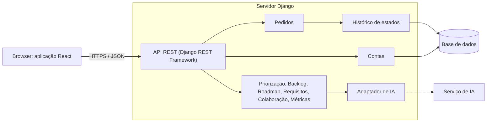

# Arquitetura

[Índice](../README.md) · [← Mockups](../03-prototipo/mockups.md) · [Registo de decisões →](decisoes.md)

Diagrama: [FigJam](https://www.figma.com/board/czxBO7U14mX4uEDGr29P41), diagrama 1. Cartão: [EDS-153](https://ubi-team-ebw5rr6y.atlassian.net/browse/EDS-153).

## Estilo: monólito modular, cliente-servidor com API REST

- **Browser:** React, com os ecrãs dos wireframes.
- **Servidor:** um só projeto Django. Cada área do produto é um módulo (uma app Django). Hoje existem `contas` e `pedidos`.
- **Camadas dentro de cada módulo:** a API só trata do HTTP (`api.py`), as regras ficam nos serviços (`servicos.py`), os modelos só guardam dados (`models.py`).
- **Base de dados:** SQLite em desenvolvimento; PostgreSQL quando entrar o Docker (Sprint 4).
- **Serviços de fora** (IA, email): sempre atrás de um adaptador com tempo limite. Ainda não existem.

## Porque é a melhor escolha para nós

| Opção | Ficou? | Porquê |
|---|---|---|
| Monólito modular | Sim | Somos cinco, com poucos sprints de código. Um servidor instala-se, testa-se e corre de uma vez. Os módulos separam as áreas, por isso cada pessoa trabalha na sua. Um módulo pode sair para um serviço próprio mais tarde, porque só fala com os outros pela sua interface. |
| Microserviços | Não | Cada serviço precisava de deploy, base de dados e comunicação próprios. Mais tempo em infraestrutura do que em funcionalidades, e o enunciado não pede essa escala. |
| Páginas geradas no servidor | Não | O roadmap, a priorização e o quadro são de arrastar, e o aviso de parecidos aparece enquanto se escreve. Isso pede uma interface que reaja sem recarregar. |

## Módulos, ecrãs e user stories

| Módulo | Ecrãs | User stories | Estado |
|---|---|---|---|
| Contas | 01, 13 | US-24, US-30 | Base feita |
| Pedidos | 02, 03, 04 | US-01 a US-05 | Base feita |
| Priorização | 05 | US-06 a US-09 | Votos feitos; resto no Sprint 4 |
| Backlog | 06, 07 | US-10 a US-13 | Sprint 4 |
| Roadmap | 08, 09 | US-14 a US-17 | Sprint 4 |
| Requisitos | 10, 11 | US-18, US-19 | Sprint 4 |
| Colaboração | 04, 12 | US-21 a US-23 | Sprint 4 |
| Métricas | 14, 15 | US-25 a US-29 | Sprint 5 |

## Ver também

- [Registo de decisões](decisoes.md)
- [Requisitos não funcionais](../02-requisitos/requisitos-nao-funcionais.md)
- [Estrutura do código](../06-codigo/estrutura.md)
