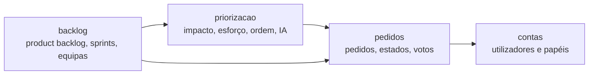

# Desenho de software

[Índice](../README.md) · [← Registo de decisões](decisoes.md) · [Casos de uso →](../05-modelacao/casos-de-uso.md)

Cartão: [EDS-161](https://ubi-team-ebw5rr6y.atlassian.net/browse/EDS-161). A [arquitetura](arquitetura.md) diz que peças há; esta página diz como cada peça está feita por dentro e como as peças falam umas com as outras.

## Três camadas em cada módulo

Cada módulo do back-end (`contas`, `pedidos`, `priorizacao`, `backlog`) é uma app Django com as mesmas três camadas:

| Ficheiro | Faz | Não faz |
|---|---|---|
| `api.py` | Recebe o pedido HTTP, valida a entrada com os serializers e traduz os erros em códigos HTTP | Não decide regras do negócio |
| `servicos.py` | As regras: quem pode fazer o quê, que mudanças são permitidas, o que se grava e em que transação | Não sabe nada de HTTP |
| `models.py` | Os dados e as restrições da base de dados (por exemplo, um voto por pessoa) | Não tem regras que dependam de quem está a usar |

Assim as regras testam-se sem passar pela API (`tests/test_servicos.py`), e a API testa-se à parte (`tests/test_api.py`).

## Dependências entre módulos

- As setas só vão num sentido. `pedidos` não conhece a priorização nem o backlog; quem chega depois é que usa quem já existe.
- Um módulo pode ler os dados de outro, mas não repete as regras dele. O backlog lê a ordem do Product Owner, que é da priorização, em vez de ter uma ordem sua.
- Os erros de regra são dois, definidos em `pedidos/servicos.py` e usados por todos: `RegraViolada` (a API responde 400) e `SemPermissao` (a API responde 403). A resposta de erro é sempre `{"erro": "frase para mostrar ao utilizador"}`.

## Padrões que usamos e porquê

| Padrão | Onde | Porquê |
|---|---|---|
| Camada de serviços | `servicos.py` de cada módulo | As regras ficam num só sítio e testam-se sem HTTP |
| Tabela de regras | `QUEM_PODE` em `pedidos/servicos.py` | As passagens de estado e quem as faz leem-se como o diagrama de estados. As transições permitidas (`TRANSICOES`) saem da mesma tabela, para não haver duas listas a manter |
| O servidor diz o que se pode fazer | `pode_mudar_para` no detalhe do pedido e nos cartões do quadro | O ecrã mostra só os botões que o papel pode usar, sem repetir as regras no front-end |
| Adaptador com alternativa | `priorizacao/ia.py` | Só um ficheiro fala com o serviço de IA. Se falhar, usa-se a regra local e a priorização continua (decisão D4) |
| Uma só porta para o servidor | `frontend/src/api.js` | Os ecrãs não chamam `fetch`. O CSRF e os erros tratam-se num sítio |

## Refactoring feito no Sprint 4

| Cheiro no código | Onde estava | O que mudou |
|---|---|---|
| Regras repetidas | As transições de estado estavam no servidor e no ecrã do detalhe (`PROXIMOS`) | O ecrã passou a usar `pode_mudar_para`, que vem do servidor |
| Duas listas para a mesma coisa | `TRANSICOES` e as permissões por papel | `TRANSICOES` é calculada a partir de `QUEM_PODE` |
| Código morto | A permissão `GerePedidos` deixou de ser usada quando as permissões passaram para os serviços | Foi apagada |
| Estilo inconsistente | Linhas longas e imports desarrumados | O ruff passou a correr no GitHub Actions e o código foi acertado |

## Ver também

- [Arquitetura](arquitetura.md)
- [Registo de decisões](decisoes.md)
- [Estrutura do código](../06-codigo/estrutura.md)
- [Testes](../06-codigo/testes.md)
