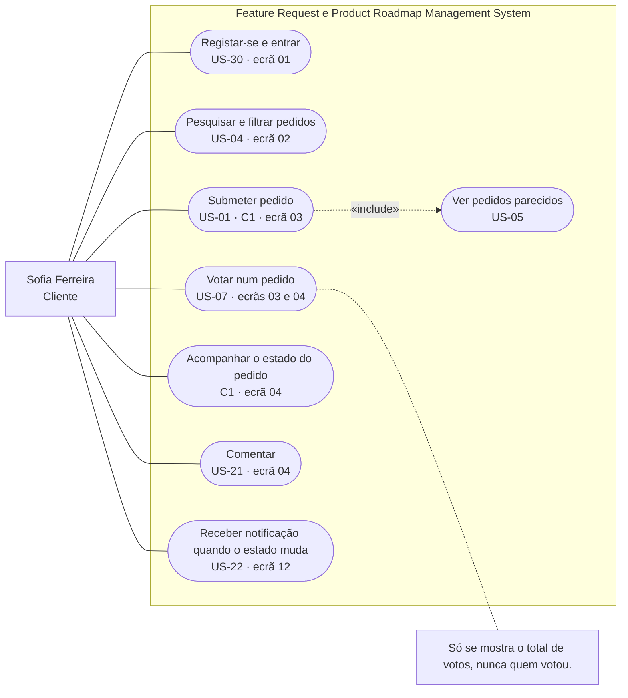
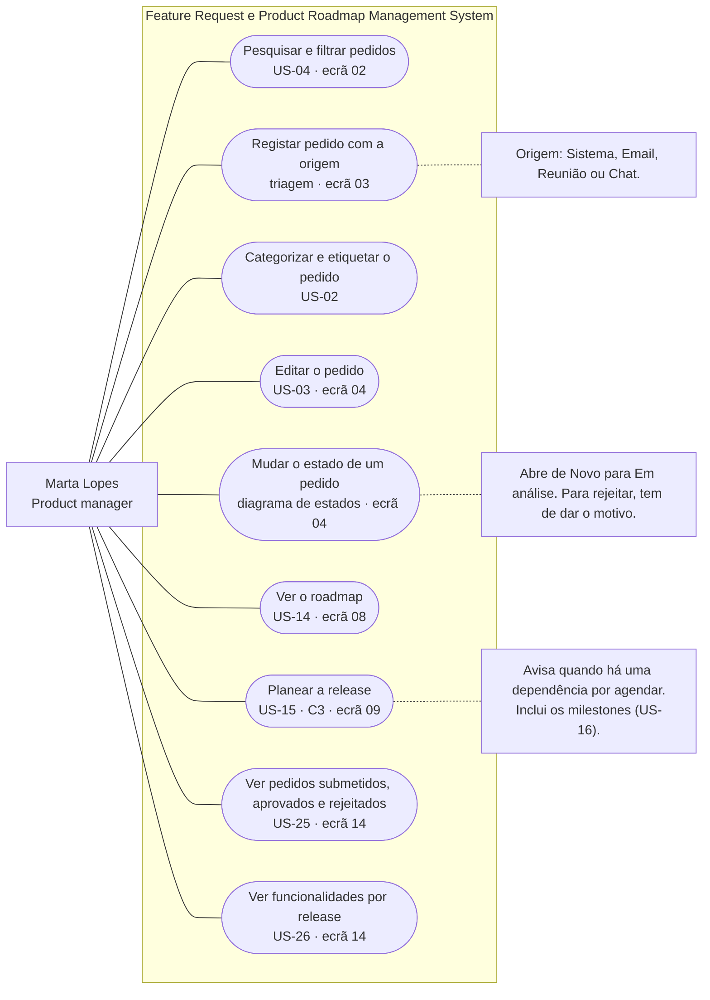
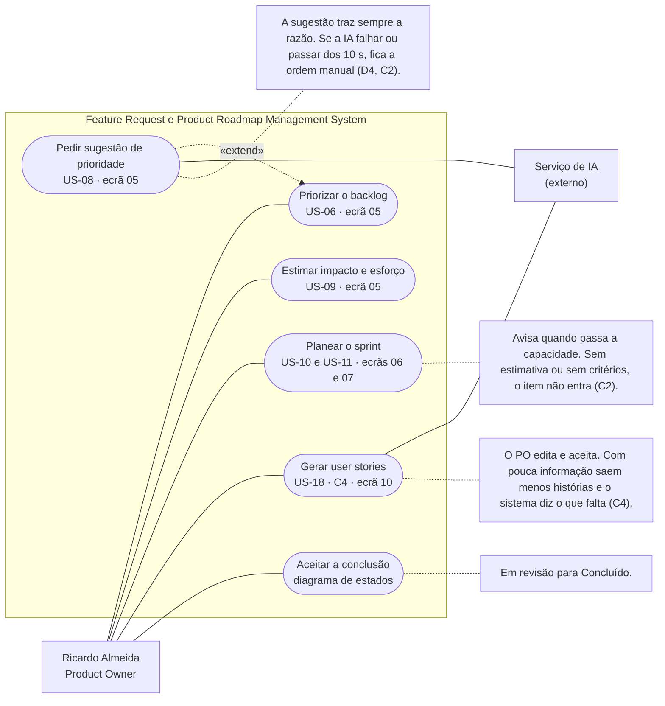
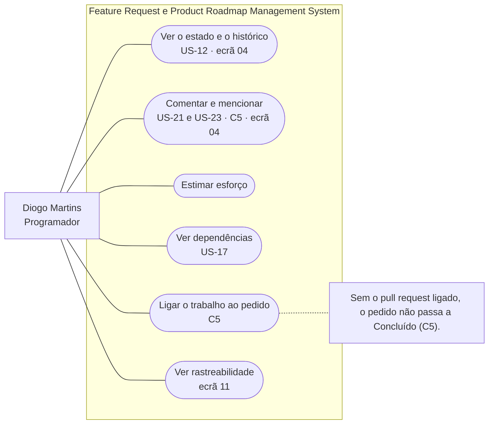
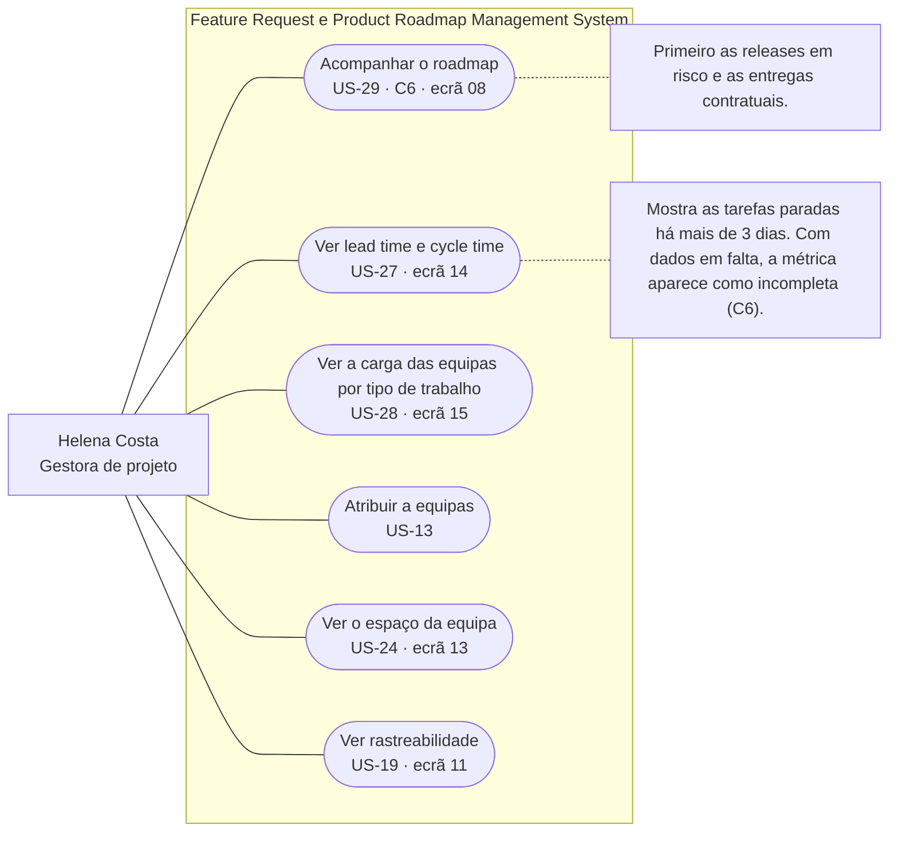

# Casos de uso

[Índice](../README.md) · [← Registo de decisões](../04-arquitetura/decisoes.md) · [Diagrama de classes →](classes.md)

Um diagrama por ator, a partir das [user stories](../01-produto/user-stories.md), dos [cenários](../01-produto/cenarios.md), dos [wireframes](../03-prototipo/wireframes.md) e da [arquitetura](../04-arquitetura/arquitetura.md). Cada caso diz de onde vem (US, cenário ou ecrã). Os mesmos diagramas estão no [FigJam](https://www.figma.com/board/czxBO7U14mX4uEDGr29P41) (diagramas 2a a 2e) e os ficheiros fonte em `docs/sprint-3/modelacao/02-casos-de-uso-*.mmd`.

## 2a. Sofia Ferreira, cliente

Ecrãs 01, 02, 03, 04 e 12. Submeter pedido inclui sempre ver os parecidos (US-05).

## 2b. Marta Lopes, product manager

Ecrãs 02, 03, 04, 08, 09 e 14. As etiquetas da US-02 ainda não têm classe no modelo; as versões da US-03 também não.

## 2c. Ricardo Almeida, Product Owner

Ecrãs 05, 06, 07 e 10. O Serviço de IA é ator secundário e só aparece aqui. Pedir sugestão estende a priorização: sem ela, o Ricardo prioriza à mão.

## 2d. Diogo Martins, programador

Ecrãs 04, 07 e 11. A US-09 é do Ricardo, mas o Diogo também estima esforço. A US-19 é da Helena, mas o Diogo também consulta a rastreabilidade quando liga o trabalho ao pedido (C5).

## 2e. Helena Costa, gestora de projeto

Ecrãs 08, 11, 13, 14 e 15.

## Quem faz o quê

| Ator | Casos de uso |
|---|---|
| Sofia, cliente | Registar-se e entrar, pesquisar e filtrar, submeter pedido (inclui ver parecidos), votar, acompanhar o estado, comentar, receber notificações |
| Marta, product manager | Pesquisar e filtrar, registar pedido com a origem, categorizar e etiquetar, editar, mudar o estado, ver o roadmap, planear a release, ver submetidos/aprovados/rejeitados, ver funcionalidades por release |
| Ricardo, Product Owner | Priorizar o backlog (estende: pedir sugestão à IA), estimar impacto e esforço, planear o sprint, gerar user stories, aceitar a conclusão |
| Diogo, programador | Ver o estado e o histórico, comentar e mencionar, estimar esforço, ver dependências, ligar o trabalho ao pedido, ver rastreabilidade |
| Helena, gestora de projeto | Acompanhar o roadmap, ver lead time e cycle time, ver a carga das equipas, atribuir a equipas, ver o espaço da equipa, ver rastreabilidade |
| Serviço de IA (externo) | Sugerir prioridades com a razão, propor user stories |

## Ver também

- [Diagrama de classes](classes.md)
- [User stories](../01-produto/user-stories.md)
