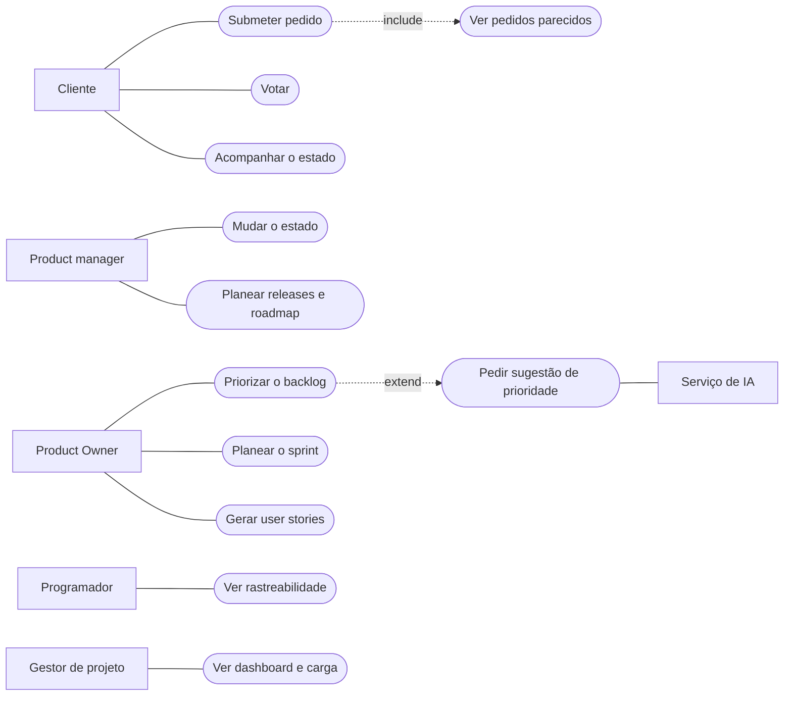

# Casos de uso

[Índice](../README.md) · [← Registo de decisões](../04-arquitetura/decisoes.md) · [Diagrama de classes →](classes.md)

Os ficheiros fonte de todos os diagramas estão em `docs/sprint-3/modelacao/` (Mermaid, um ficheiro por diagrama), para se poderem alterar e voltar a gerar.

Diagrama 2 no [FigJam](https://www.figma.com/board/czxBO7U14mX4uEDGr29P41). Aqui fica a mesma informação em texto.

| Ator | Casos de uso |
|---|---|
| Cliente | Registar-se e entrar, submeter pedido (inclui ver parecidos), votar, pesquisar, acompanhar o estado, comentar |
| Product manager | Mudar o estado de um pedido, pesquisar, planear releases e roadmap |
| Product Owner | Priorizar (estende: pedir sugestão à IA), estimar impacto e esforço, planear o sprint, gerar user stories |
| Programador | Comentar e mencionar, estimar esforço, ver rastreabilidade |
| Gestor de projeto | Ver dashboard e carga das equipas, acompanhar o roadmap |
| Serviço de IA (externo) | Sugerir prioridades, propor user stories |

## Ver também

- [Diagrama de classes](classes.md)
- [User stories](../01-produto/user-stories.md)
