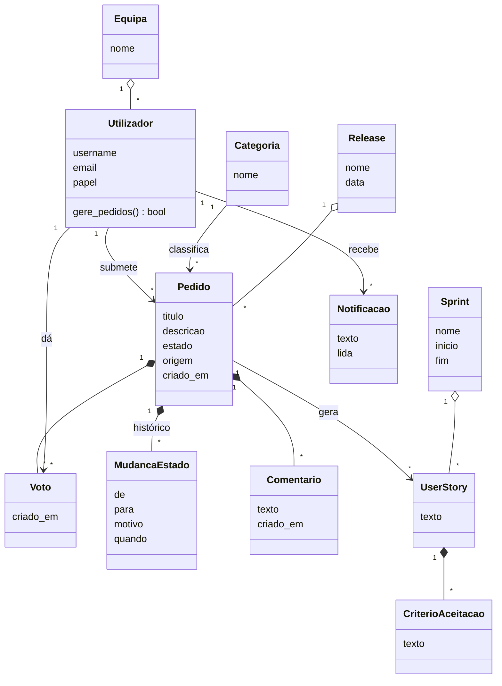

# Diagrama de classes

[Índice](../README.md) · [← Casos de uso](casos-de-uso.md) · [Diagramas de sequência →](sequencia.md)

O FigJam não faz diagramas de classes, por isso este fica em Mermaid (o GitHub mostra-o como imagem). O modelo de dados com as tabelas está no [FigJam](https://www.figma.com/board/czxBO7U14mX4uEDGr29P41), diagrama 7.

Utilizador, Pedido, Categoria, Voto e MudancaEstado já existem no código (`backend/contas/models.py` e `backend/pedidos/models.py`). As outras são do desenho e entram nos próximos sprints.

Regras que o diagrama não mostra mas o código garante:

- um voto por pessoa e por pedido (restrição na base de dados);
- as mudanças de estado seguem o [diagrama de estados](estados-e-atividades.md).

## Ver também

- [Diagramas de sequência](sequencia.md)
- [Estrutura do código](../06-codigo/estrutura.md)
