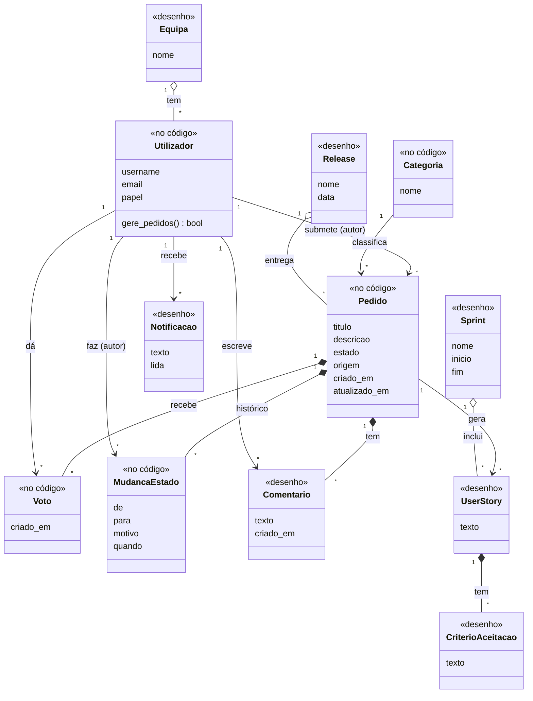
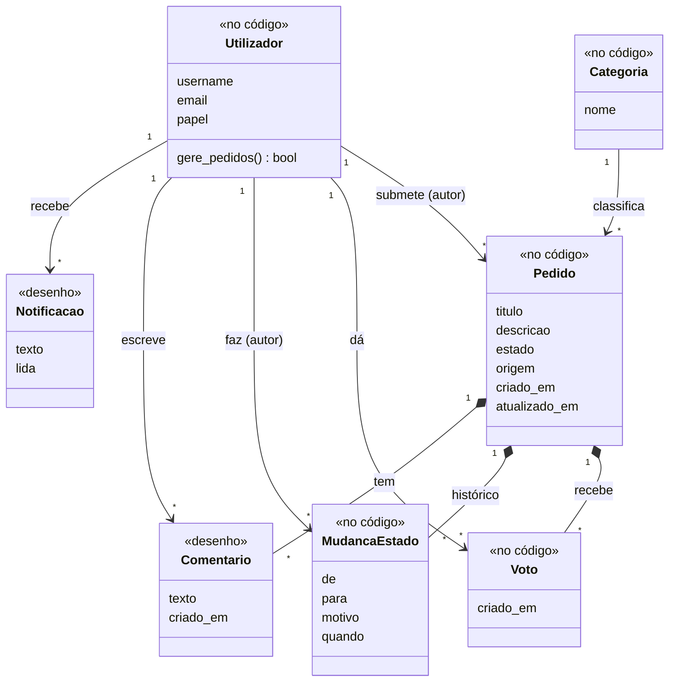
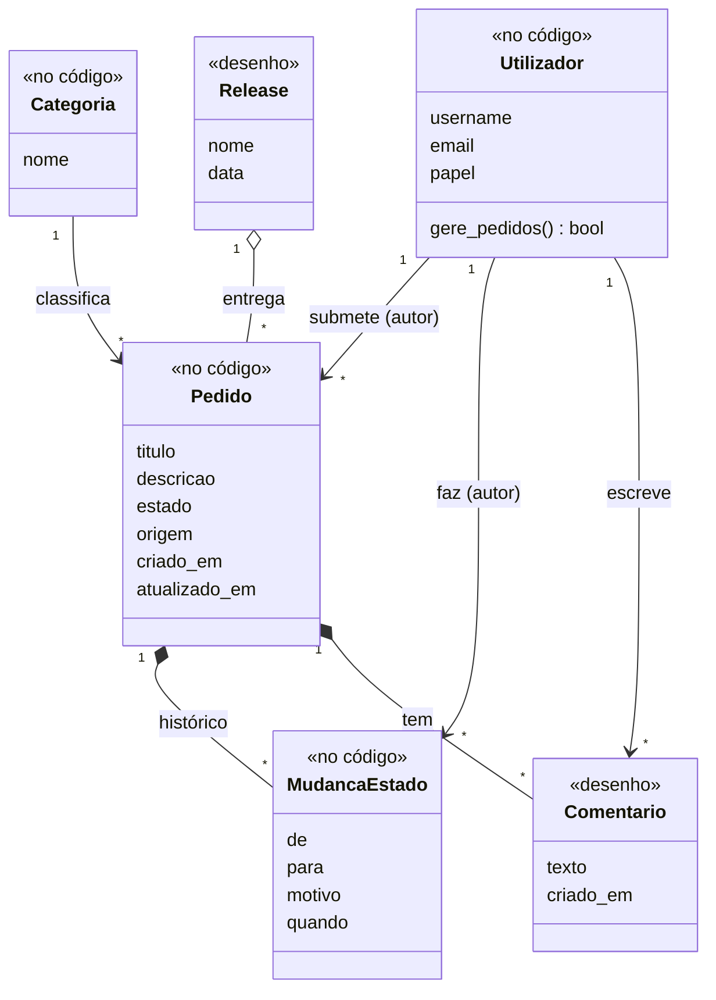
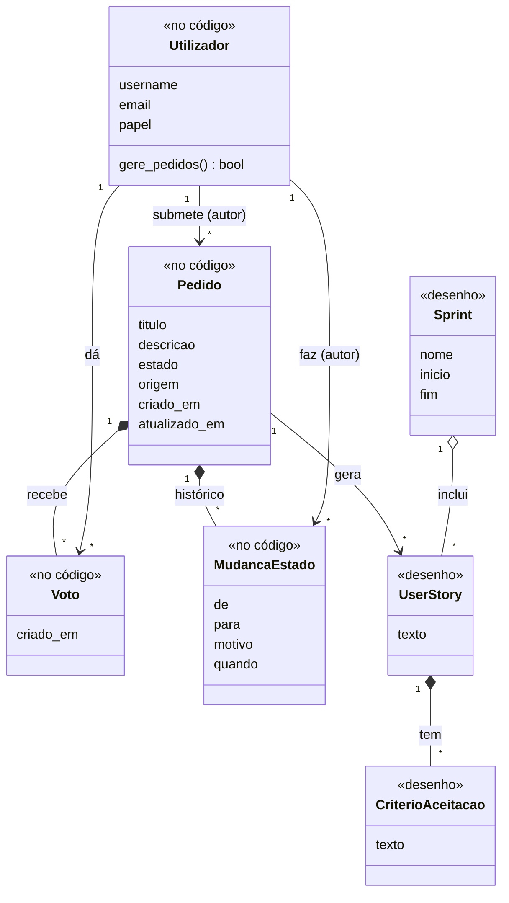
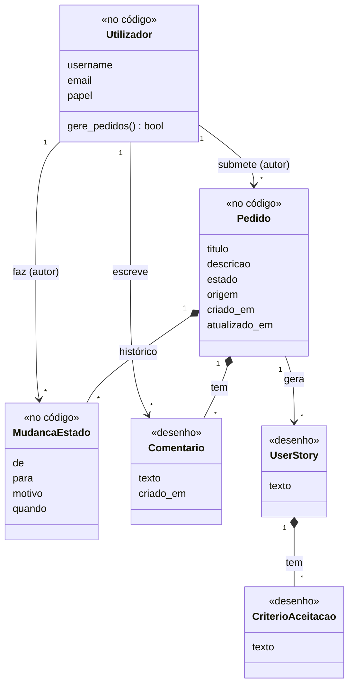
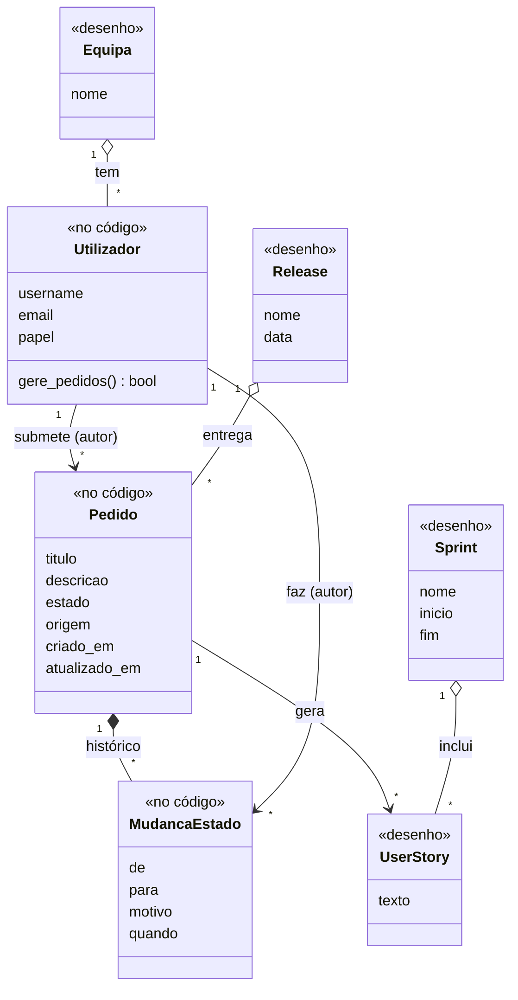

# Diagrama de classes

[Índice](../README.md) · [← Casos de uso](casos-de-uso.md) · [Diagramas de sequência →](sequencia.md)

O FigJam não faz diagramas de classes, por isso este fica em Mermaid (o GitHub mostra-o como imagem). Bate com o modelo de dados do [FigJam](https://www.figma.com/board/czxBO7U14mX4uEDGr29P41), diagrama 7. Os ficheiros fonte estão em `docs/sprint-3/modelacao/08-classes*.mmd`.

«no código» quer dizer que a classe já existe (`backend/contas/models.py` e `backend/pedidos/models.py`). «desenho» quer dizer que entra nos próximos sprints. O autor do pedido e o autor da mudança de estado aparecem como ligações a Utilizador ("submete" e "faz").

## Modelo completo

Regras que o diagrama não mostra mas o código garante:

- um voto por pessoa e por pedido (restrição na base de dados);
- as mudanças de estado seguem o [diagrama de estados](estados-e-atividades.md).

## Por persona

Cada vista só tem as classes que a persona usa nos seus [casos de uso](casos-de-uso.md). Os nomes e as ligações são os do modelo completo.

### Sofia

A Sofia usa pedido, categoria, votos, histórico de estados, comentários e notificações.

### Marta

A Marta usa pedido, categoria, histórico de estados, comentários e releases.

### Ricardo

O Ricardo usa pedido, votos, histórico de estados, user stories, critérios de aceitação e sprints.

### Diogo

O Diogo usa pedido, histórico de estados, comentários, user stories e critérios de aceitação.

### Helena

A Helena usa equipas, pedido, histórico de estados, user stories, sprints e releases.

A Helena atribui trabalho a equipas (US-13), mas o modelo ainda não diz o que fica ligado à equipa. Fica por decidir.

## Ver também

- [Diagramas de sequência](sequencia.md)
- [Estrutura do código](../06-codigo/estrutura.md)
