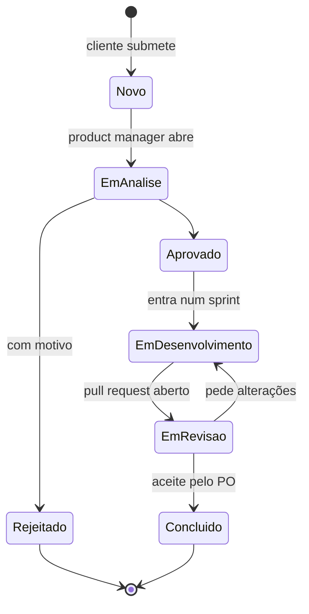
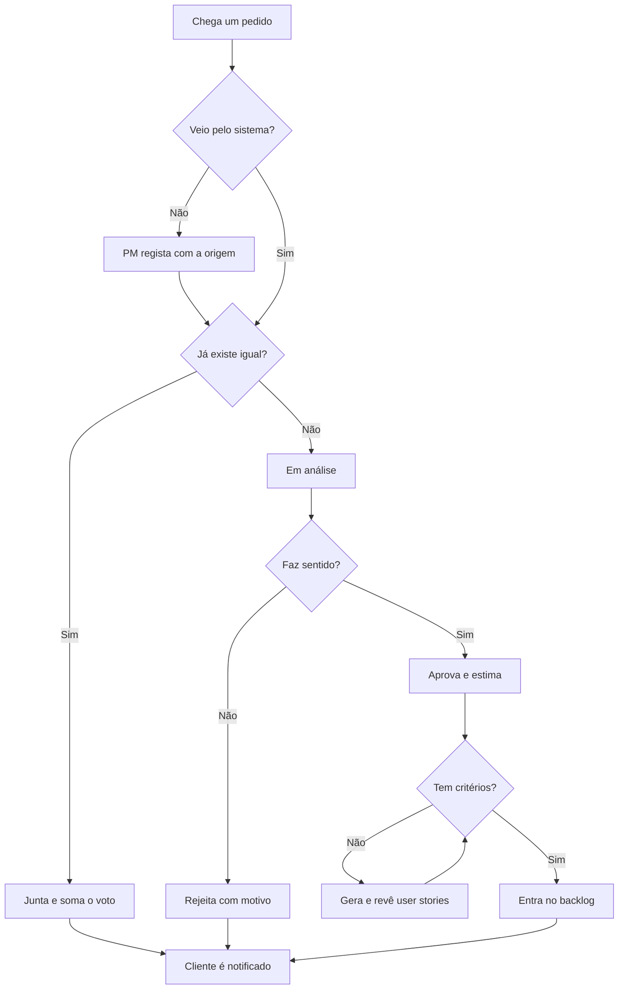

# Estados e atividades

[Índice](../README.md) · [← Diagramas de sequência](sequencia.md) · [Como correr o projeto →](../06-codigo/como-correr.md)

Diagramas 5 e 6 no [FigJam](https://www.figma.com/board/czxBO7U14mX4uEDGr29P41).

## Estados de um pedido

Os estados são os da US-12 ([EDS-120](https://ubi-team-ebw5rr6y.atlassian.net/browse/EDS-120)). O código recusa as transições que não estão aqui (`TRANSICOES` em `backend/pedidos/servicos.py`).

## Atividades: triagem de um pedido

## Ver também

- [Diagrama de classes](classes.md)
- [Registo de decisões](../04-arquitetura/decisoes.md)
