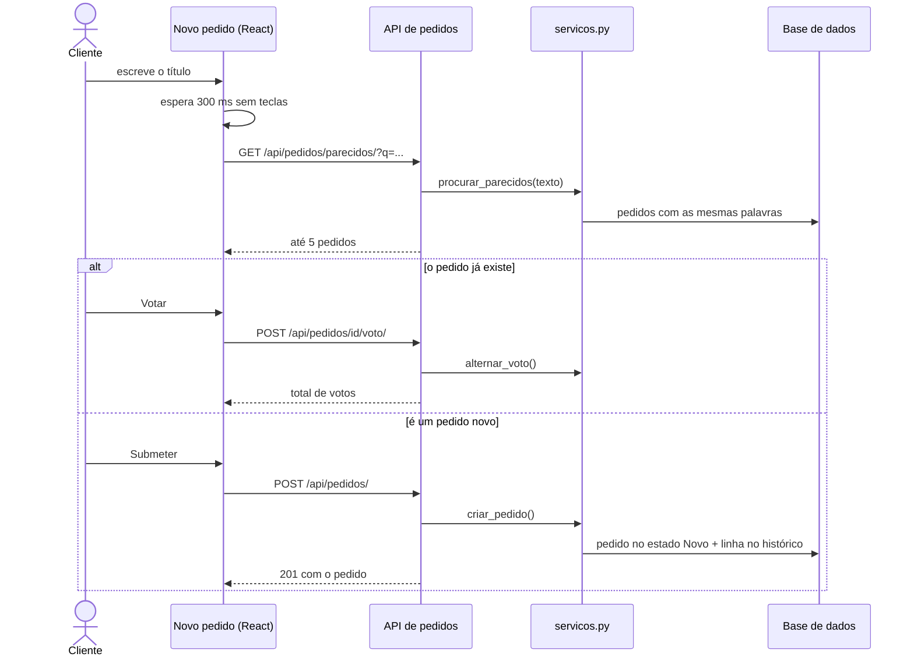

# Diagramas de sequência

[Índice](../README.md) · [← Diagrama de classes](classes.md) · [Estados e atividades →](estados-e-atividades.md)

Diagramas 3 e 4 no [FigJam](https://www.figma.com/board/czxBO7U14mX4uEDGr29P41).

## Submeter um pedido com aviso de parecidos (cenário C1)

É o que está implementado na base do código.



## Sugestão de prioridade quando a IA falha (cenário C2)

Desenhado para o Sprint 4.

```mermaid
sequenceDiagram
    actor PO as Product Owner
    participant UI as Priorização
    participant API as API de priorização
    participant A as Adaptador de IA
    participant IA as Serviço de IA
    PO->>UI: Pedir sugestão
    UI->>API: POST /api/priorizacao/sugestao
    API->>A: sugerir(pedidos)
    A->>IA: pedido com tempo limite de 10 s
    alt responde a tempo
        IA-->>A: ordem e razão de cada pedido
        API-->>UI: sugestão com razões
        PO->>UI: Aceitar ou Manter a minha ordem
    else falha ou passa o tempo
        A-->>API: sem sugestão
        API-->>UI: aviso; a priorização manual continua
    end
```

## Ver também

- [Estados e atividades](estados-e-atividades.md)
- [Cenários](../01-produto/cenarios.md)
